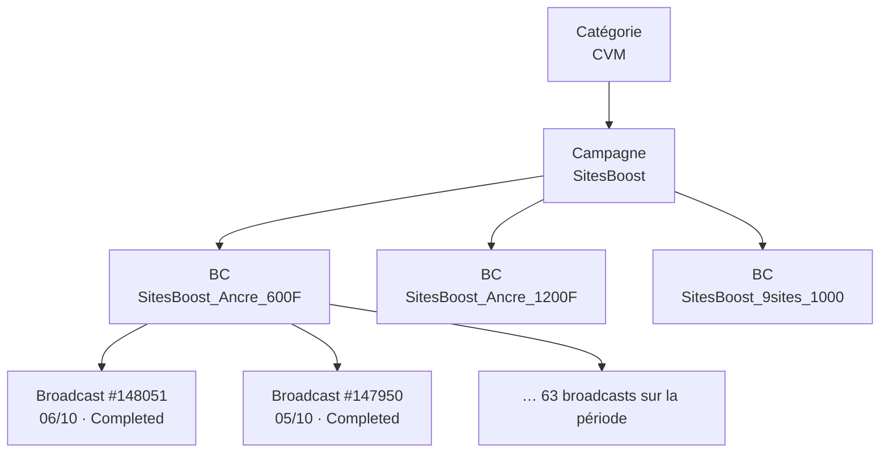

# Yas CVM Monitor : guide de la plateforme

Document de référence pour expliquer la plateforme : à quoi elle sert, d'où viennent les données, comment chaque indicateur est calculé, comment les alertes sont décidées, et comment lire chaque écran.

Les noms de fichiers entre `code` renvoient au dépôt (dossier `src/cvm_monitor/`). Chaque formule ci-dessous est celle du code, pas une approximation.

---

## 1. En une phrase

Chaque jour, un fichier Excel « Daily Dashboard » est déposé. La plateforme le lit, stocke l'historique, calcule les indicateurs, détecte les anomalies de campagnes, suit leur cycle de vie (nouvelle, en cours, résolue) et alerte l'équipe par e-mail et Teams. Un tableau de bord permet d'explorer.

## 2. Vue d'ensemble du flux

```
Daily Dashboard (.xlsb)
        │  dépôt dans inbox/ (ou import via le dashboard)
        ▼
 1. INGESTION        ingest/loader.py, schema.py   lecture, renommage, nettoyage
        ▼
 2. STOCKAGE         storage/ (SQLite)             1 snapshot = 1 fichier, historique complet
        ▼
 3. DÉTECTION        detect/ (règles)              anomalies du snapshot
        ▼
 4. CYCLE DE VIE     storage/repository.py         nouvelle / en cours / résolue / rouverte
        ▼
 5. SORTIES          CSV · e-mail · Teams · dashboard · rapport Excel
```

Point d'entrée : `pipeline.process_file` enchaîne les cinq étapes. Un fichier déjà traité est reconnu par son empreinte SHA-256 et ignoré.

### Les commandes

| Commande | Rôle |
|---|---|
| `run` | Traite les fichiers de `inbox/`, détecte, notifie, archive |
| `backfill` | Historise d'anciens fichiers sans notifier ni déplacer |
| `watch` | Surveille `inbox/` et traite à l'arrivée d'un fichier |
| `status`, `list` | État et liste des anomalies |
| `ack` | Acquitte ou met en sourdine des anomalies |
| `report` | Rapport Excel hebdomadaire ou mensuel |
| `preview`, `notify-test` | Aperçu de l'e-mail, test des canaux |
| `dashboard`, `serve` | Sert le tableau de bord statique et les actions (acquitter, importer) |
| `build-site` | Régénère le tableau de bord statique |

---

## 3. Les données d'entrée

Un fichier par jour, nommé `Yas_Senegal_Daily_Dashboard_till_<JJ>_<Mois>_<AAAA>.xlsb`. La **date du snapshot** est lue dans le nom du fichier. Il contient deux feuilles.

### 3.1 Data_Push : les campagnes sortantes

**Grain : une ligne par broadcast et par jour d'envoi.**

| Colonne source | Nom interne | Signification |
|---|---|---|
| Scheduled Date | `date` | Jour d'envoi |
| Broadcast ID / Name | `broadcast_id`, `broadcast_name` | Un envoi précis |
| **BC Name** | `bc_name` | Le « Broadcast Config » : regroupe les envois d'une même programmation. C'est l'entité principale des alertes |
| Campaign Name / ID | `campaign_name`, `campaign_id` | La campagne |
| Campaign Category | `category` | Famille : Bundle Drive, Churn_Reactive, CVM, DATAFRAMEWORK, Engagements, Informative, Nursery, Retention_CPM, Upsell, Voice, UAT (test). Voir la hiérarchie ci-dessous |
| Status | `status` | État du broadcast (voir 3.3) |
| Generated | `generated` | Messages **préparés** (cible générée) |
| Sent | `sent` | Messages **envoyés** à l'opérateur |
| Acknowledged | `acknowledged` | Messages **acquittés** (accusé de réception) |
| Delivered | `delivered` | Messages **délivrés** au client |
| Conversions | `conversions` | Conversions (achats, souscriptions) attribuées |
| Unique Conversions | `unique_conversions` | Clients distincts ayant converti |
| Conversion Value | `conversion_value` | Valeur monétaire des conversions |
| Fulfillment Success / Failure | `fulfillment_success`, `fulfillment_failure` | Activations de l'offre réussies / échouées |
| Overall Ctrl Grp | `cg_size` | Taille du **groupe de contrôle** (clients volontairement non contactés) |
| Overall Ctrl Grp Conversions | `cg_conversions` | Conversions du groupe de contrôle |
| Is Seeding | `is_seeding` | Envoi « seeding » (bonus crédité directement) |

Les colonnes de pourcentage de la source (`Acknowledged %`, `Conversion %`, …) sont lues mais **les indicateurs sont recalculés** à partir des volumes, pour éviter toute incohérence.

#### Hiérarchie Push : de la catégorie au broadcast

Les lignes Data_Push s'organisent en quatre niveaux emboîtés. Chaque niveau a **un seul parent** (vérifié sur les fichiers d'août à octobre 2026 : aucune campagne dans deux catégories, aucun BC dans deux campagnes).

```
CATÉGORIE                 Campaign Category     ex. CVM
 └─ CAMPAGNE              Campaign Name / ID    ex. SitesBoost
     └─ BC                BC Name               ex. SitesBoost_Ancre_600F
         └─ BROADCAST     Broadcast ID / Name   ex. #148051 · envoi du 06/10/2026 · Completed
```



| Niveau | Colonne NEON-dx | Ce que c'est | Parent |
|---|---|---|---|
| **Catégorie** | `Campaign Category` | Famille métier (CVM, Informative, Engagements, Retention_CPM…) | — |
| **Campagne** | `Campaign Name` / `Campaign ID` | Programme marketing (ex. SitesBoost, Inactivity Campaign) | une seule catégorie |
| **BC** | `BC Name` | Broadcast Config : une programmation de la campagne (message, offre, cible). Entité principale des alertes | une seule campagne |
| **Broadcast** | `Broadcast ID` / `Broadcast Name` | Un envoi daté : une exécution du BC, avec statut, volumes et conversions | un seul BC |

Un BC récurrent produit **un broadcast par jour d'envoi** : `SitesBoost_Ancre_600F` compte ainsi 63 broadcasts sur la période.

Exemple réel :

```
CVM  (2 campagnes · 30 BC · 334 broadcasts)
 └─ SitesBoost
     ├─ SitesBoost_Ancre_600F      63 broadcasts → #148051 (06/10), #147950 (05/10), …
     ├─ SitesBoost_Ancre_1200F     59 broadcasts → #148060 (06/10), #147957 (05/10), …
     └─ SitesBoost_9sites_1000     41 broadcasts → #145425 (18/09), …
```

Volumes observés sur les fichiers du 01/08 au 06/10/2026 (11 catégories · 52 campagnes · 564 BC · 5 298 broadcasts) :

| Catégorie | Campagnes | BC | Broadcasts |
|---|---:|---:|---:|
| Informative | 7 | 276 | 1 508 |
| Engagements | 2 | 51 | 833 |
| Bundle Drive Campaign | 5 | 52 | 701 |
| Nursery Campaign | 6 | 17 | 699 |
| DATAFRAMEWORK | 4 | 71 | 561 |
| Retention_CPM | 16 | 42 | 372 |
| CVM | 2 | 30 | 334 |
| Voice Campaigns | 3 | 8 | 148 |
| Upsell Campaign | 2 | 2 | 90 |
| Churn_Reactive | 4 | 9 | 46 |
| UAT (test) | 1 | 6 | 6 |

Points d'attention :

- **Nom de BC qui change** : pour 8 broadcasts, NEON-dx a ajouté l'horodatage au nom du BC d'un fichier à l'autre (`Adu boost followup_ILLIMAX 200F` → `Adu boost followup_ILLIMAX 200F-01 Sep 2026 14:00 GMT`). Le `Broadcast ID` reste la clé fiable d'un envoi.
- **Agrégation** : à chaque niveau, les volumes (Sent, Conversions…) sont **sommés**, puis les taux recalculés. On ne fait jamais la moyenne des taux des niveaux inférieurs.
- **Dans le tableau de bord** : l'onglet Push › « Campagnes » suit l'arbre Campagne → BC → Broadcast (catégorie affichée à côté de chaque campagne) ; « Par catégorie » descend d'une catégorie vers ses campagnes ; « Top des BC » classe les BC par volume, base par envoi (Sent moyen d'un broadcast) ou fréquence (jours d'envoi) ; un clic ouvre la fiche de la campagne, du BC ou du broadcast.

### 3.2 Data_IM : l'inbound (Interaction Manager)

**Grain : une ligne par jour, touchpoint, règle de programme et offre.**

| Colonne | Nom interne | Signification |
|---|---|---|
| Touchpoint | `touchpoint` | Canal : USSD ou YAS APP |
| Program / Program Rule | `program`, `rule_name`, `rule_id` | Programme et règle qui décide quelle offre proposer |
| Offer Name / ID | `offer_name`, `offer_id` | Offre proposée |
| Impressions | `impressions` | Nombre de fois où l'offre a été **présentée** |
| Fulfillment Success | `fulfillment_success` | Achats / activations réussis (« Total Successful Purchases ») |
| Fulfillment Failures | `fulfillment_failures` | Tentatives échouées |
| Accepted / Declined / May be Later | `accepted`, `declined`, `maybe_later` | Réponses du client |
| Last Refresh Date Time | `last_refresh` | Dernière mise à jour de la règle |

### 3.3 Les statuts Push

| Statut | Sens |
|---|---|
| Completed | Terminé normalement |
| Delivering | Livraison en cours |
| Paused | En pause |
| Aborted / Delivery Stalled | Arrêté / bloqué |
| Blackout Pause / Blackout Expired | Suspendu par une fenêtre de silence (« blackout ») ou expirée |

### 3.4 Nettoyage à la lecture

- Les dates Excel (numéros de série) sont converties en `AAAA-MM-JJ`.
- Les colonnes de comptage sont converties en entiers (vide = 0).
- Les pourcentages de la source (0 à 100) sont ramenés à une fraction (0 à 1).
- Les lignes sans date ou sans identifiant sont écartées.
- Si une colonne obligatoire manque, le traitement s'arrête avec un message clair : le format du fichier a changé.
- On calcule `age_days` = date du snapshot − date d'envoi. C'est **l'âge d'un envoi**, clé de la notion de maturité (section 5).

---

## 4. Les indicateurs (formules)

Tous sont dans `analytics/kpi.py`. Quand une division a un dénominateur nul, le résultat est « vide » (jamais 0 ni infini).

### 4.1 Push : l'entonnoir

L'entonnoir décrit le parcours d'un message :

`Generated → Sent → Acknowledged → Delivered → Conversions → Fulfillment Success`

| Indicateur | Formule | Lecture |
|---|---|---|
| **Delivery%** | `Delivered ÷ Sent` | Part des messages envoyés qui arrivent au client |
| **Acknowledged %** | `Acknowledged ÷ Sent` | Part acquittée par l'opérateur. Normalement proche de 100 % |
| **Conv%** (TG) | `Conversions ÷ Sent` | Taux de conversion de la cible contactée (Target Group) |
| **% CG Conversion** | `CG Conversions ÷ CG size` | Taux de conversion du groupe de contrôle : ce qui se serait passé **sans** message |
| **% Net Conversion** | `Conv% − % CG Conversion` | Effet **incrémental** de la campagne, en points |
| **Fulfillment Failure%** (Push) | `Failure ÷ (Success + Failure)` | Part des activations échouées |
| **Conv incrémentales** | `% Net Conversion × Sent` | Nombre de conversions « gagnées » grâce à la campagne |

Les agrégations (par jour, par catégorie, par campagne) **somment les volumes d'abord, puis calculent le taux** : un taux global n'est jamais la moyenne de taux.

### 4.2 Inbound

| Indicateur | Formule | Lecture |
|---|---|---|
| **Impression** | somme | Offres présentées |
| **Total Successful Purchases** | somme de Fulfillment Success | Achats réussis |
| **Conv% / Take rate** | `Fulfillment Success ÷ Impressions` | Taux de transformation d'une présentation en achat |
| **Fulfillment Failures%** | `Failures ÷ (Success + Failures)` | Part des tentatives d'achat échouées |

### 4.3 Tuiles du haut du dashboard (« Overview »)

Pour le dernier jour disponible : la valeur du jour, et l'écart par rapport à **la moyenne des 7 jours précédents**.
- Volumes (Sent, Conv, Impression, achats) : écart en %.
- Taux (Delivery%, Fulfillment Failures%) : écart en **points** de pourcentage.
- Les Conv du jour sont **non définitives** : elles continuent d'arriver les jours suivants (voir section 5).

---

## 5. La maturité des conversions

**Problème.** Les conversions d'un envoi n'arrivent pas toutes le jour même : un client peut acheter plusieurs jours après. Un envoi de la veille paraît donc mauvais alors qu'il est simplement trop jeune.

**Constat réel dans les données.** Pour les envois du 01/09, les conversions sont passées de 3 092 (premier fichier) à 10 848 (22 jours plus tard), soit ×3,5.

**Règle de la plateforme.** Les règles de conversion ne jugent que les envois **matures** : `age_days ≥ maturity_days` (3 jours par défaut, `config.yaml`, clé `detection.maturity_days`).

**Courbe de maturation** (`analytics/maturity.py`, page « Maturité des Conv »).
1. Pour chaque broadcast présent dans plusieurs fichiers, on retient ses conversions « finales » (mesurées à J+14 ou plus).
2. À chaque âge plus jeune, on calcule : `conversions déjà connues ÷ conversions finales`. C'est la part de complétude.
3. Le **nowcast** divise les conversions d'un jour récent par la complétude de son âge, pour estimer ce qu'il donnera à maturité : `conversions attendues = conversions observées ÷ complétude`.

**Limite.** Elle repose sur les envois observés dans plusieurs fichiers. Avec 2 fichiers, seul le 01/09 est observé deux fois : la courbe s'affinera avec les jours.

---

## 6. L'uplift : la campagne a-t-elle vraiment servi ?

Principe : comparer le groupe contacté (TG) au groupe de contrôle (CG). Si le TG ne convertit pas plus que le CG, la campagne n'a rien apporté.

Test utilisé (`analytics/uplift.py`) : **test z de différence de deux proportions**.
- `p1 = conversions uniques TG ÷ Sent`, `p2 = conversions CG ÷ taille CG`.
- Uplift = `p1 − p2`.
- Statistique `z = (p1 − p2) ÷ erreur-type poolée`, puis p-value bilatérale.
- Intervalle de confiance à 95 % : `uplift ± 1,96 × erreur-type`.
- **Significatif** si p-value < 0,05.

Verdict affiché par campagne :

| Verdict | Condition |
|---|---|
| CG = 0 | Pas de groupe de contrôle : comparaison impossible |
| CG Conv < 30 | Trop peu de conversions dans le CG pour conclure |
| Non significatif | L'écart peut être dû au hasard |
| Net Conversion + / − | Écart significatif, positif ou négatif |

Ne sont évalués que les envois matures. Le seeding est exclu par défaut.

**Précision.** Le test d'une campagne utilise les **conversions uniques** du TG. La colonne « % Net Conversion » des tableaux journaliers utilise, elle, les conversions totales : de petits écarts entre les deux sont normaux.

---

## 7. Les règles de détection

## 7.0 Alertes business : le jeu notifié

Seules les règles « actionnables » alertent (mail / Teams). Question test : *quelqu'un doit-il agir aujourd'hui pour protéger des conversions ou du revenu ?*

| Règle | Alerte |
|---|---|
| BIZ-CONV-01 | un BC convertit moins que sa propre normale (P5 des 28 jours précédents), chiffré en conversions et valeur perdues |
| BIZ-OFR-01 | une offre Inbound a un taux d'achat sous sa propre normale, chiffré en achats perdus |
| PM-PRF-02 | uplift négatif significatif (major si ≥ 500 conversions perdues) |
| PM-PRF-03, IM-FUL-01 | offre non livrée (échecs de fulfillment) |
| PM-EXE-01, PM-EXE-02 | broadcast à gros volume bloqué ou arrêté, hors blackout |
| FEED-01, FEED-03 | fichier du jour absent, métrique clé à 0 |

Toutes les autres règles sont plafonnées à `info` (`max_severity: info` dans `config.yaml`) : visibles dans l'onglet Alertes, jamais notifiées. Aucune donnée n'est masquée.

**Blackout SMS** (`detection.sms_blackout`, 19h-07h) : réglementaire, donc normal. Un arrêt dans cette fenêtre n'alerte pas (`RuleContext.in_blackout`), et les heures de blackout sont exclues du classement des heures d'envoi. Minuit pile = flow déclenché, jamais considéré comme blackout.

Chaque alerte porte `details.impact` (chiffrage) et `details.action` (suggestion), repris dans le digest et la carte Teams.

**Analytique « quand envoyer »** (`services/timing.py`, onglet Analytics > Quand envoyer) : jour et heure d'envoi classés par indice de conversion (conversions ÷ conversions attendues au Conv % habituel des mêmes BC, donc indépendant du mix de campagnes), meilleurs créneaux jour × heure, BC en déclin (7 j vs 28 j) et meilleurs BC.


Une **règle** observe un snapshot et produit des **anomalies**. Chacune a : un identifiant (ex. `PM-DLV-03`), une sévérité, une entité concernée, un volume impacté et un message explicatif.

Préfixes : `PM` = Push, `IM` = Inbound, `SNP` = comparaison de snapshots, `FEED` = le flux NEON-dx lui-même. Familles : `EXE` exécution, `DLV` livraison, `PRF` performance, `FUL` fulfillment, `IMP` impressions, `DQ` qualité des données.

### 7.1 Deux familles de règles

**A. Règles à état ou à cohérence (binaires)** : un fait est vrai ou faux, il n'y a pas de seuil à calibrer.

| Règle | Détecte |
|---|---|
| PM-EXE-01 | Broadcast bloqué en « Delivering » depuis au moins 1 jour |
| PM-EXE-02 | Broadcast Aborted ou Delivery Stalled |
| PM-EXE-03 | Broadcast Paused |
| PM-EXE-04 | Broadcast en Blackout (rétrogradé en **info** : attendu, consultation seule) |
| PM-EXE-05 | Generated ≥ 1 000 mais Sent = 0 (ciblé, jamais envoyé) |
| PM-EXE-06 | Blackout expiré avant l'envoi : volume ciblé jamais parti (Sent ≤ 1 % de Generated) |
| PM-EXE-07 | Statut transitoire ou inconnu (Targeting, Render Scheduled…) depuis au moins 1 jour |
| PM-PRF-02 | Uplift négatif **significatif** (le test z de la section 6) |
| PM-DQ-01 | Sent > Generated |
| PM-DQ-02 | Conversions > Sent pour une campagne |
| PM-DQ-03 | Fulfillment Success > Conversions |
| PM-DQ-04 | Pas de groupe de contrôle (CG = 0) alors que Sent ≥ 1 000 |
| PM-DQ-05 | Colonne entièrement vide |
| PM-DQ-06 | Jour manquant dans les données |
| IM-DQ-01 | Conversions IM non alimentées (conv ÷ succès < 1 %) |
| IM-DQ-02 | Touchpoint avec impressions mais aucun fulfillment |
| IM-DQ-03 | Règle IM Active non rafraîchie depuis plus de 48 h (référence : lendemain du fichier, 06 h GMT) |
| SNP-01 | Broadcast **révisé** : des chiffres censés être figés ont changé depuis le fichier précédent |
| SNP-02 | Broadcasts **disparus** : vus dans un fichier antérieur du même mois, absents du fichier courant. Comparé à tout l'historique : l'alerte reste ouverte tant qu'ils manquent ; le changement de mois n'est pas une disparition |
| SNP-03 | Données IM de jours clos modifiées |

**B. Règles de performance par percentiles (relatives)** : ce qui est « anormal » est défini par la distribution réellement observée, pas par un chiffre fixé à la main. C'est le cœur de la méthode (section 8).

| Règle | Métrique | Mauvais si | Référence |
|---|---|---|---|
| PM-DLV-01 | Delivery% par BC | trop bas | pairs de la catégorie |
| PM-DLV-03 | Acknowledged % par BC | trop bas | pairs de la catégorie |
| PM-PRF-01 | Conv% par BC (envois matures) | trop bas | pairs de la catégorie |
| PM-PRF-03 | Fulfillment Failure% par BC | trop haut | pairs de la catégorie |
| IM-FUL-01 | Failure% par règle IM (7 derniers jours) | trop haut | pairs du touchpoint |
| IM-IMP-01 | fulfillment ÷ impressions par règle IM | trop bas | pairs du touchpoint |
| PM-DLV-02 | Delivery% journalier (par catégorie et total) | trop bas | historique propre |
| IM-FUL-02 | Failure% journalier IM global | trop haut | historique propre |
| IM-IMP-02 | Impressions journalières (par touchpoint et programme) | trop bas | historique propre |

**C. Règles sur le flux NEON-dx** : elles jugent la donnée, pas les campagnes. Une donnée manquante ou un format qui
change doit être signalé (et remonté à Flytxt) avant de fausser les autres règles.

| Règle | Détecte |
|---|---|
| FEED-01 | Jours sans fichier depuis le début du mois (majeure en fin de mois ou à partir de 3 jours) |
| FEED-02 | Colonnes ajoutées ou retirées, nouvelle valeur de Status / catégorie / touchpoint / programme, colonne qui se remplit (info) ou se vide |
| FEED-03 | Métrique vide (ou quasi) des jours où son volume existe alors qu'elle est renseignée les autres jours du fichier (ex. fulfillment IM du 01 au 18/08) ; remplissage d'une colonne en forte baisse |
| FEED-04 | Au premier fichier d'un mois : envois de fin du mois précédent sortis des fichiers avant maturité, conversions estimées manquantes |
| FEED-06 | Conversions des envois récents qui progressent beaucoup moins que la courbe de maturité : attribution en retard |

Le fichier attendu mais **non reçu** ne peut pas être détecté à l'import : `cvm-monitor run` (inbox vide) et
`cvm-monitor feed-check` alertent une fois par fichier attendu après l'heure limite (`feed.deadline`, 10 h par défaut).

Les références d'historique (PM-DLV-02) excluent les jours où la métrique n'était pas alimentée, sans cesser de
juger ces jours. Les pairs des règles IM sont d'abord les règles du même touchpoint **et** programme, puis du
touchpoint s'il y a moins de 20 pairs. La chute d'impressions (IM-IMP-02) tient compte du jour de semaine.

### 7.2 Périmètres appliqués avant le calcul

- **BC techniques exclus** : les BC dont le nom contient « Dummy BC » (`technical_bc_patterns`) ne sont pas de vrais messages.
- **Règles de conversion** : catégories Informative et Engagements exclues (pas d'objectif de conversion) ainsi que les envois en seeding.
- **Regroupement** : les règles par BC additionnent d'abord tous les envois du même BC Name, puis évaluent un seul taux. Un BC envoyé 10 jours donne une alerte, pas dix.

---

## 8. L'approche par percentiles

### 8.1 Pourquoi

Avec un seuil fixe (ex. « Acknowledged % < 90 % »), une campagne normale mais structurellement différente déclenche une alerte tous les jours. Résultat avant le changement : 274 anomalies ouvertes sur 22 jours, dont 87 pour le seul seuil d'acquittement. Trop de bruit pour qu'on les lise.

Un **percentile** répond à la question : « cette valeur est-elle exceptionnelle par rapport aux autres ? ». Le P5 est la valeur sous laquelle se trouvent 5 % des observations ; le P50 est la médiane ; le P95 est la valeur au-dessus de laquelle ne se trouvent que 5 % des observations.

### 8.2 Les niveaux (modifiables dans `config.yaml`, bloc `detection.percentiles`)

| Niveau | Valeur | Usage |
|---|---|---|
| `low` | P5 | Métrique « bas = mauvais » : on alerte **en dessous** |
| `median` | P50 | Repère central, affiché dans le message |
| `normal_high` | P75 | Borne haute de la plage normale, affichée dans le message |
| `high` | P95 | Métrique « haut = mauvais » : on alerte **au-dessus** |

On n'alerte qu'aux extrêmes (P5 ou P95). Alerter aussi à P25 ou P75 signalerait un quart des BC en permanence, à l'opposé de l'objectif.

### 8.3 Deux façons de définir la référence

**Comparaison aux pairs** (règles par BC ou par règle IM).
On compare chaque entité aux autres **du même jour et du même groupe** : la catégorie pour le Push, le touchpoint pour l'IM. Avantage : fonctionne dès le premier fichier et ne dépend pas de la saison.

**Comparaison à l'historique propre** (séries journalières).
On compare la valeur d'un jour à la distribution des **28 jours précédents** de la même série. Avantage : capte les ruptures (« la livraison de la catégorie CVM s'effondre »). Il faut au moins 10 jours d'historique.

### 8.4 Les garde-fous contre le bruit

1. **Volume minimum** (`min_sent`, `min_attempts`, `min_impressions`) : on ignore les entités trop petites pour que leur taux ait un sens.
2. **Écart minimal à la médiane** (`min_abs_gap`, ou `min_rel_gap` en relatif) : si tout le monde est entre 94,9 % et 95,0 %, le P5 existe mais un écart de 0,1 point n'est pas un problème.
3. **Effectif minimal** : au moins 20 pairs dans le groupe. Sinon on utilise toute la population ; si elle est trop petite aussi, on retombe sur l'ancien seuil fixe (`fallback_to_static`).
4. **Épisodes** : pour les séries journalières, les jours hors norme **consécutifs** forment **une seule alerte** (« du 16 au 19/09, 4 jours »). Un jour isolé est de sévérité *minor* ; deux jours de suite ou plus prennent la sévérité de la règle.
5. **Regroupement des zéros structurels** (PM-DLV-01) : quand le P5 vaut 0 (beaucoup de BC à Delivered = 0 comme les « NBO_Value Segment_* »), ces BC sont regroupés en **une alerte par catégorie** plutôt qu'une par BC.
6. **Choix du mode** : `mode: static` sur une règle remet son ancien seuil fixe pour les règles par BC.

Chaque alerte indique sa position dans la distribution, par exemple : « Acknowledged % 35,3 %. P5 = 36,4 %, médiane = 98,8 %, plage normale ≤ 99,9 %, n = 97 ». Un lecteur peut ainsi vérifier pourquoi elle existe.

### 8.5 Résultat mesuré

Rejeu sur le snapshot du 22/09 (9 règles converties) : **120 alertes avec les seuils fixes → 26 avec les percentiles**.

| Règle | Avant | Après |
|---|---|---|
| PM-DLV-01 | 33 | 4 |
| PM-DLV-03 | 52 | 9 |
| PM-PRF-01 | 15 | 0 |
| IM-FUL-01 | 8 | 2 |
| PM-DLV-02, PM-PRF-03, IM-FUL-02, IM-IMP-02 | 7, 3, 1, 1 | 7, 2, 1, 1 |

Ce qui reste correspond à des écarts réels : chute de Delivery% du 16 au 19/09, Illimax à environ 35 % d'acquittement, hausse des échecs IM du 15 au 18/09.

---

## 9. La sévérité

Quatre niveaux : **info < minor < major < critical**.

1. Chaque règle a une sévérité de base (`config.yaml`).
2. **Ajustement au volume** (`RuleContext.scaled`) :
   - volume impacté ≥ 500 000 (`critical_volume`) : **un cran de plus** ;
   - volume impacté < 1 000 (`low_volume`) : plafonné à **minor**.
3. Cas particuliers : IM-FUL-01 passe en *critical* si le taux d'échec atteint 90 %. PM-EXE-04 est plafonné à *info*.

Le « volume impacté » est propre à chaque règle (messages non délivrés, conversions perdues, …) et sert aussi à **classer** les alertes : sévérité d'abord, puis volume décroissant.

---

## 10. Le cycle de vie d'une anomalie

Chaque anomalie a une **empreinte** (`règle | type d'entité | clé de l'entité | date`) qui évite les doublons d'un fichier à l'autre.

| Statut | Signification |
|---|---|
| `open` | Active, à traiter |
| `ack` | Acquittée par quelqu'un (avec auteur et note) |
| `muted` | Mise en sourdine (jamais ré-escaladée) |
| `resolved` | Disparue au dernier fichier |

À chaque nouveau fichier (`sync_anomalies`) :
- Anomalie jamais vue → **nouvelle** (`open`), à notifier.
- Anomalie `resolved` qui revient → **rouverte**, à notifier.
- Sévérité plus haute qu'avant → **aggravée** : elle repasse `open` même si acquittée (sauf `muted`), à notifier.
- Sinon → **en cours** : compteur d'occurrences incrémenté.
- Anomalie active non revue, d'une règle exécutée, dans la période couverte → **résolue**.

---

## 11. Les sorties et alertes

| Canal | Contenu | Réglage (`notify` dans `config.yaml`) |
|---|---|---|
| **E-mail** | Récapitulatif HTML : KPI du jour vs 7 j, comptage par sévérité, nouvelles anomalies (≥ minor), critiques et majeures encore ouvertes, résolues, CSV joint | `min_severity: minor` |
| **Teams** | Carte avec les nouvelles anomalies ≥ major (5 maximum), plus des **rappels** | `min_severity: major`, `max_items: 5` |
| **CSV** | `reports/anomalies_<date>.csv` (anomalies open et ack, séparateur `;`, ouverture directe sous Excel FR) | automatique |
| **Rapport Excel** | Synthèse hebdo ou mensuelle : jours, catégories, campagnes, BC, IM, anomalies | commande `report` |

- **Rappel** : une anomalie encore ouverte et déjà notifiée depuis plus de 3 jours (`realert_after_days`) est rappelée.
- **Fichier non reçu** : après l'heure limite, une alerte Teams / e-mail par fichier attendu (journal `notifications`, canal `feed-check:<date>`).
- Les anomalies `info` ne sont jamais envoyées par e-mail ni Teams : elles restent dans le dashboard et le CSV.
- Chaque envoi est tracé dans la table `notifications`.

---

## 12. Le tableau de bord

Lancement : `cvm-monitor serve` (ou `dashboard`), port 8000. Le site est une page statique **régénérée après chaque
import et chaque acquittement** (`site/build.py`) : toutes les données y sont embarquées, filtres et onglets sont
calculés dans le navigateur, sans requête réseau à l'affichage. Les agrégations du navigateur (`site/static/kpi.js`)
reprennent les formules de `analytics/kpi.py` (un test vérifie la parité) ; les statistiques (percentiles, z-test,
maturité) sont pré-calculées en Python pour les périodes 7 j, 30 j, mois en cours et tout l'historique.

| Onglet | Ce qu'on y voit | Question à laquelle il répond |
|---|---|---|
| **Push Campaigns** | Jour J (écart vs 7 j et vs même jour de semaine), exécution au dernier fichier et transitions de statut, entonnoir, séries, carte de chaleur, top des BC (volume, base par envoi, fréquence ; BC techniques exclus par défaut), explorateur Campagne → BC → Broadcast, versions successives d'un broadcast | « Nos envois partent-ils, arrivent-ils, convertissent-ils ? » |
| **Inbound Marketing** | Jour J, touchpoints, programmes, règles IM et leur fraîcheur, offres | « Les offres présentées sont-elles achetées, les données sont-elles à jour ? » |
| **Analytics** | Incrémentalité (uplift, IC 95 %, verdict), potentiel d'amélioration, distributions et seuils, tendances, maturité par métrique, arrivée des données | « Qu'est-ce que ça rapporte, où agir, peut-on se fier aux chiffres ? » |
| **Alertes** | Santé du flux NEON-dx, file de traitement avec acquittement, tendance, catalogue, notifications | « Que dois-je traiter et prévenir aujourd'hui ? » |

### 12.1 Complétude d'un chiffre

| État | Affichage | Sens |
|---|---|---|
| Définitif | normal | La valeur ne bougera plus |
| En maturation | *italique pointillé*, estimation « ≈ X à maturité » | Âge inférieur à l'âge de référence ; estimation = observé ÷ complétude de la courbe de la métrique |
| Non renseigné | `n/r` | NEON-dx ne fournit pas la donnée (ex. Generated des flows) : ce n'est pas 0 |
| Tronqué | badge « tronqué » | Envoi de fin de mois sorti des fichiers avant maturité (le fichier ne couvre que le mois en cours) |
| Disparu | badge « disparu » | Broadcast absent des fichiers suivants **du même mois** : perte côté NEON-dx |

Les courbes de maturité sont calculées **métrique par métrique** (`analytics/maturity.maturity_curves`) :
Sent, Acknowledged, Delivered et CG size sont complets dès J0 ; conversions, valeur, fulfillment et conversions du
groupe de contrôle arrivent sur trois à quatre jours.

### 12.2 Santé du flux NEON-dx

Bandeau de l'onglet Alertes et pastille de l'en-tête. Signaux calculés sur les fichiers reçus : fraîcheur du
dernier fichier, fichiers manquants, lignes en baisse d'un fichier au suivant dans un même mois, broadcasts disparus,
envois tronqués en fin de mois, colonnes dont le remplissage change (une colonne vide est suivie : elle peut se
remplir à J+x), jours IM sans fulfillment, touchpoint sans fulfillment.

## 13. Configuration

Tout est dans `config/config.yaml`. Sections : `paths`, `ingest`, `detection` (maturité, volumes, exclusions, percentiles), `rules` (une ligne par règle : activation, sévérité, minimums), `notify`. Les secrets (webhook Teams, SMTP) sont dans `config/.env`, jamais dans le dépôt.

Exemples de réglages utiles :
- Rendre une règle plus sensible : baisser `min_abs_gap` ou `min_sent`.
- Désactiver une règle : `enabled: false`.
- Revenir à l'ancien seuil fixe : `mode: static`.
- Ignorer un type de BC technique : l'ajouter à `technical_bc_patterns`.

---

## 14. Limites connues et points d'attention

- **Historique court.** Au démarrage : 22 jours dans un seul mois. Les percentiles d'historique propre n'ont pas de recul saisonnier (semaine, fin de mois). À recalibrer après 2 à 3 semaines d'usage.
- **Un P5 existe toujours.** Par construction, 5 % des pairs sont sous le P5, même si tout va bien. Les garde-fous (écart minimal, volume minimal) limitent ce biais mais ne l'éliminent pas.
- **Conversions récentes incomplètes.** Les jours les plus récents sont toujours sous-estimés ; ne jamais conclure sur un envoi de moins de 3 jours.
- **Règles d'état non relatives.** Il reste du bruit hors percentiles : EXE-02 (Aborted/Stalled), EXE-03 (Paused), DQ-04 (pas de groupe de contrôle).
- **BC « NBO_Value Segment_* »** : Delivered à 0 sur 31 BC. Probablement des BC techniques ; s'ils le sont, les ajouter à `technical_bc_patterns`.
- **Fenêtre d'attribution** (3, 7 ou 15 jours) et **taille minimale du groupe de contrôle** : questions de métier encore ouvertes.

---

## 15. Glossaire

| Terme | Définition |
|---|---|
| **Snapshot** | Une photo : le contenu d'un fichier Daily Dashboard à une date |
| **BC (Broadcast Config)** | Programmation d'envoi regroupant plusieurs broadcasts |
| **TG / CG** | Target Group (contacté) / Control Group (non contacté, référence) |
| **Uplift / Net Conversion** | Conversions gagnées grâce au message = TG − CG |
| **Fulfillment** | Activation effective de l'offre chez le client après l'achat |
| **Seeding** | Envois dont le bonus est crédité directement, sans parcours de conversion |
| **Blackout** | Fenêtre pendant laquelle l'envoi est interdit |
| **Touchpoint** | Canal d'une offre inbound (USSD, application YAS) |
| **Maturité** | Âge à partir duquel les conversions d'un envoi sont jugées assez complètes |
| **Percentile Pn** | Valeur sous laquelle se trouvent n % des observations |
| **Pairs** | Autres entités du même groupe (catégorie, touchpoint) au même moment |
| **Épisode** | Suite de jours hors norme consécutifs, traitée comme une seule alerte |
| **Empreinte** | Identifiant unique d'une anomalie, pour éviter les doublons |
